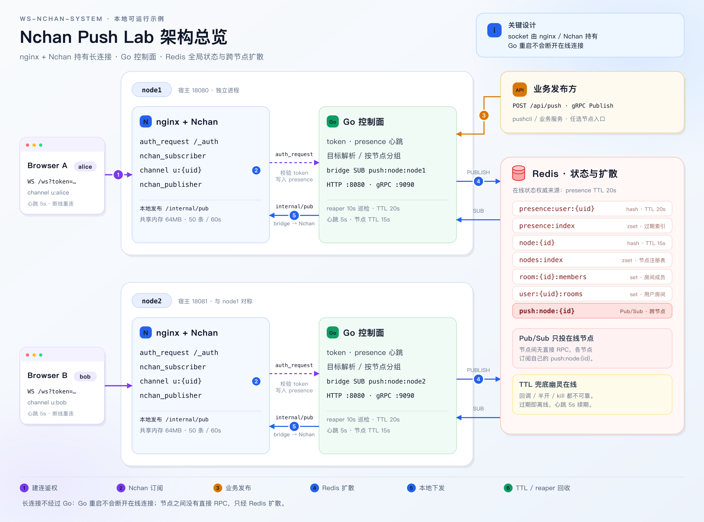

# Nchan Push Lab

一套可在本地完整运行的可扩展消息推送系统：

- **接入层**：nginx 1.26 + Nchan 1.3.7（长连接、channel 订阅、WebSocket 广播）
- **控制面**：Go 服务（token 鉴权、全局 Session、在线状态、节点注册、HTTP/gRPC 发布、Redis 桥接）
- **状态与扩散**：Redis（在线状态 TTL、节点注册表、房间成员、Pub/Sub 跨节点扩散）
- **前端**：原生 HTML/CSS/JS 实验台（连接、心跳、断线重连、定向/房间/广播、在线用户、房间管理）

默认单节点，一条命令可拉起双节点集群，用于观察跨节点消息扩散与节点故障自愈。

---

## 架构



> 图源文件：[`docs/architecture.svg`](docs/architecture.svg)。修改后可重新导出 PNG：
>
> ```bash
> rsvg-convert -z 2 docs/architecture.svg -o docs/architecture.png
> ```

三条关键路径：

1. **建连**：`WS /ws?token=` → nginx `auth_request` 调 Go 校验 token 并写入 presence → 成功后 Nchan 订阅 `u:{uid}`。
2. **推送**：业务方 `POST /api/push` 或 gRPC `Publish` → Go 解析目标 → 按 presence 找到目标节点 → Redis `PUBLISH push:node:{id}` → 该节点 bridge 调本地 `POST /internal/pub/u:{uid}` → Nchan 下发。
3. **清理**：前端主动 `/api/logout` 立即删除 presence；异常断开靠 20s TTL 过期；节点宕机由其他节点的 reaper 在约 15s 内清理其路由记录。

**长连接不经过 Go**：socket 全部由 nginx/Nchan 持有，Go 只做控制面与消息转发，Go 重启不会断开在线连接。

---

## 快速开始

依赖（本机已具备）：

- Docker + Docker Compose
- Go 1.25（用于把服务端交叉编译成 linux/arm64 二进制）
- Node 22+（仅测试脚本需要，使用内置 WebSocket）
- 接入层镜像 `ws-nchan-nginx:local`：由 [`deploy/nginx.Dockerfile`](deploy/nginx.Dockerfile) 从 `debian:trixie-slim` 构建，安装 nginx + `libnginx-mod-nchan`，不依赖机器上预置的镜像

```bash
make up        # 编译 Go 二进制 + 构建 app 镜像 + 启动 redis / app / nginx
```

打开两个窗口：

- http://localhost:18080/?uid=alice
- http://localhost:18080/?uid=bob

点击“连接并订阅”，在其中一个窗口选择目标用户/房间/广播并发送消息。

```bash
make logs      # 查看全部服务日志
make down      # 停止并删除容器（Redis 关闭持久化，每次启动都是干净状态）
make clean     # 停止并删除容器、卷与本地二进制
```

### 端口映射

| 服务 | 宿主机 | 说明 |
|---|---|---|
| node1 前端/WS/API | `18080` | 主入口 |
| node2 前端/WS/API | `18081` | 双节点模式 |
| Redis | `16379` | 便于本地排查 |
| node1 gRPC | `19090` | `pushcli` 使用 |
| node2 gRPC | `19091` | 双节点模式 |

> 8080/6379/9091 在本机已被其他容器占用，因此统一映射到 1xxxx 段。

首次 `make up` 会自动构建网关镜像（安装 nginx 与 Nchan 模块，需要访问 Debian 软件源）。Dockerfile 默认使用 `mirrors.aliyun.com`，如需换源：

```bash
DEBIAN_MIRROR=deb.debian.org make up
# 或单独构建：
docker build --build-arg DEBIAN_MIRROR=mirrors.tuna.tsinghua.edu.cn \
  -f deploy/nginx.Dockerfile -t ws-nchan-nginx:local .
```

---

## 双节点集群

```bash
make up-cluster

node scripts/e2e-cluster.mjs
```

Alice 通过 `18080`（node1）连接，Bob 通过 `18081`（node2）连接；消息经 Redis 跨节点转发。

观察故障自愈：

```bash
docker compose --profile cluster stop node2-app node2-nginx
# 立刻发布给 node2 上的用户：online_recipients=1, failed_recipients=1（幽灵会话窗口）
# 约 15s 后：online=0, offline=1（node 注册过期 + reaper 清理）
docker compose --profile cluster start node2-app node2-nginx
```

直接观察 Redis：

```bash
docker exec -it ws-nchan-redis redis-cli
ZRANGE presence:index 0 -1
HGETALL presence:user:alice
ZRANGE nodes:index 0 -1 WITHSCORES
PUBSUB CHANNELS push:node:*
```

---

## 验证

```bash
make e2e             # 12 项：鉴权拒绝、定向、房间、广播、离线计数、心跳、主动下线、TTL 回收
make e2e-cluster     # 6 项：双节点路由、双向跨节点投递、节点注册表
CONNECTIONS=300 make loadtest
make pushcli ARGS="-grpc 127.0.0.1:19090 -from ops -type user -id bob -text hello"
```

本机实测（Apple Silicon / Docker Desktop）：

- 单节点 e2e：**12/12 通过**
- 双节点 e2e：**6/6 通过**
- 300 个 WebSocket：建连 119ms；广播 300/300 到达，总耗时 75ms，p95 66ms；定向投递 3ms
- 节点宕机：故障瞬间 `failed_recipients=1`，约 15s 后 presence 与节点注册被清理，再发布变为 `online=0/offline=1`
- nginx 重启后前端自动重连（约 1s，指数退避 + 抖动）

---

## 目录结构

```
cmd/server/          服务端入口（HTTP + gRPC + 心跳 + reaper）
cmd/pushcli/         gRPC 发布 CLI
internal/auth/       HMAC token 签发与校验
internal/store/      Redis：presence、节点注册表、房间、Pub/Sub
internal/push/       目标解析、在线判定、按节点分组、消息构造
internal/bridge/     Redis Pub/Sub -> 本地 Nchan 发布
internal/nchan/      本地 Nchan publisher 客户端
internal/httpapi/    HTTP API 与 auth_request 端点
internal/grpcapi/    gRPC Publish（内部 token 鉴权）
internal/stats/      每节点内存计数器
api/push.proto       gRPC 定义
internal/pb/         生成的 Go 代码（已提交，构建无需 protoc）
deploy/              nginx 模板、app/nginx Dockerfile
docs/                架构图（SVG 源文件 + PNG）
web/                 前端实验台
scripts/             e2e / cluster / loadtest
```

---

## API

| 方法 | 路径 | 鉴权 | 说明 |
|---|---|---|---|
| WS | `/ws?token=&uid=` | token | 建立长连接，订阅 `u:{uid}` |
| GET | `/api/dev/token?uid=` | 无（仅 `DEV_MODE=true`） | 开发用签发 token |
| POST | `/api/heartbeat` | Bearer | 续期 presence（前端每 5s 一次） |
| POST | `/api/logout` | Bearer | 主动下线，立即清理 presence |
| GET | `/api/me` | Bearer | 当前用户、节点、房间 |
| GET | `/api/online` | Bearer | 全局在线列表（uid + 节点） |
| POST | `/api/push` | Bearer | 推送：`{target_type, target_id, payload}` |
| POST | `/api/rooms/{room}/join` `/leave` | Bearer | 加入/退出房间 |
| GET | `/api/rooms/{room}` | Bearer | 成员及在线状态 |
| GET | `/api/stats` | 无 | 节点计数、在线数、注册表 |
| GET | `/healthz` | 无 | 存活探针 |
| gRPC | `push.v1.PushService/Publish` | `x-internal-token` | 业务侧高频发布 |
| POST | `/internal/pub/{channel}` | `X-Publisher-Token` + 内网 IP | 仅本机 bridge 调用，外网返回 403 |

`target_type` 支持 `user` / `room` / `broadcast`。

推送响应示例：

```json
{
  "msg_id": "msg_cb0f...",
  "online_recipients": 1,
  "offline_recipients": 0,
  "failed_recipients": 0,
  "nodes": ["node2"]
}
```

`failed_recipients > 0` 通常表示“presence 仍存在但目标节点的 bridge 已消失”，即节点故障后的幽灵窗口。

---

## Redis 数据模型

| Key | 类型 | 内容 | TTL |
|---|---|---|---|
| `presence:user:{uid}` | hash | `uid, node_id, since, last_hb` | 20s，心跳续期 |
| `presence:index` | zset | uid → 过期时间戳 | 读时裁剪 |
| `node:{id}` | hash | `id, addr, started_at, last_hb` | 15s |
| `node:{id}:users` | zset | 该节点承载的 uid → presence 过期时间 | 读时裁剪 |
| `nodes:index` | zset | 节点 → 过期时间戳 | 读时裁剪 |
| `room:{id}:members` | set | 房间成员 | 持久 |
| `user:{uid}:rooms` | set | 用户已加入房间 | 持久 |
| `push:node:{id}` | Pub/Sub | 跨节点消息通道 | 不存储 |

**presence TTL 是在线状态的权威来源**。断开回调、TCP 半开、进程被 kill 都不可靠，只有 TTL 能保证不出现永久幽灵在线。

---

## 设计取舍

### 1. 长连接与业务进程解耦

Nchan 在 nginx 的 C 层管理订阅和广播，单 worker 可承载大量连接；Go 只处理鉴权、路由和发布。代价是 Go 无法直接读取/操作 socket，客户端上行必须走 HTTP。

### 2. Session 一致性：先注册、再订阅

`auth_request` 在 Nchan 建立订阅之前完成 token 校验与 presence 写入，避免“显示在线但收不到消息”。反向的空窗（已注册但握手失败）由 20s TTL 兜底消化。

### 3. 单用户单 channel

每个连接只订阅 `u:{uid}`，房间消息在写入侧展开（fan-out on write）：查房间成员 → 按成员 presence 定位节点 → 逐个投递。这样 Nchan 侧无需多路复用协议，代价是广播/大房间的 fan-out 由 Go 逐个 PUBLISH 完成。

### 4. 多节点只经过 Redis

任意节点收到发布请求后都只发 Redis，各节点 bridge 再落本地 Nchan。节点之间没有直接 RPC，新增节点只需启动进程并写心跳。

### 5. 消息幂等与重放

Nchan 会为新订阅者重放最近 60s、最多 50 条缓冲消息，因此重连可能收到重复帧。消息统一带 `msg_id`，前端按 id 去重。页面刷新后内存去重表清空，历史缓冲可能再次出现（见“已知限制”）。

### 6. 双向语义的边界

下行：Nchan → WebSocket。上行：HTTP (`/api/push`) 或 gRPC。不要在 Nchan 里实现业务协议，否则 channel 会退化成自研 IM 协议栈。

---

## 配置项

| 环境变量 | 默认 | 说明 |
|---|---|---|
| `NODE_ID` | `node1` | 节点标识 |
| `HTTP_ADDR` | `:8080` | HTTP 监听 |
| `GRPC_ADDR` | `:9090` | gRPC 监听 |
| `REDIS_ADDR` | `127.0.0.1:6379` | Redis 地址 |
| `NCHAN_PUB_URL` | `http://127.0.0.1:8081/internal/pub` | 本地 Nchan 发布端点 |
| `TOKEN_SECRET` | 开发值 | HMAC 密钥 |
| `INTERNAL_TOKEN` | 开发值 | gRPC 内部鉴权 + Nchan 发布头 `X-Publisher-Token` |
| `TOKEN_TTL` | `1h` | token 有效期 |
| `PRESENCE_TTL` | `20s` | 在线状态过期时间 |
| `HEARTBEAT_INTERVAL` | `5s` | 前端心跳间隔（由 token 接口下发） |
| `NODE_TTL` | `15s` | 节点注册过期时间 |
| `REAP_INTERVAL` | `10s` | 故障节点巡检周期 |
| `DEV_MODE` | `true` | 是否开放 `/api/dev/token` |

---

## 已知限制与扩展方向

- **单 uid 单 session**：presence 以 uid 为粒度，多标签页同 uid 会互相覆盖；一个标签页主动下线会让另一个短暂显示离线，5s 心跳后自愈。需要多端在线时，把 key 改为 `presence:user:{uid}:{conn_id}` 并维护 uid → 连接集合。
- **无离线消息持久化**：Redis Pub/Sub 是 fire-and-forget；在线判定失败即丢弃。需要离线消息时，在发布前落 Redis Stream / DB，上线后按游标拉取。
- **缓冲重放不是可靠投递**：Nchan 的 50 条 / 60s 缓冲只是重连体验优化，不保证不丢；跨刷新去重可把最近 `msg_id` 存入 localStorage/sessionStorage。
- **广播 fan-out 为串行**：当前逐用户 Redis PUBLISH + 逐条本地发布；大规模广播可改为按节点批量投递、bridge 侧并发 worker（注意同用户消息保序）。
- **Nchan 共享内存是单机资源**：`nchan_shared_memory_size` 只在单 nginx 内生效；需要跨机共享 channel 状态时可启用 Nchan 的 Redis 引擎，或继续沿用本项目的“Redis Pub/Sub + 本地发布”模式。
- **token 放在 query string**：浏览器 WebSocket 无法自定义 Header；已通过 nginx 日志格式去掉 query 规避日志泄漏，生产建议改用一次性 ticket（先 HTTP 换取短时票据再建连）。
- **开发态接口**：`DEV_MODE=true` 时任何人可签发 token；生产必须关闭并由业务鉴权服务签发。
- **未使用 OpenResty/Lua**：本机镜像为 nginx + Nchan 动态模块。在线注册用 `auth_request` 完成，清理用 TTL + reaper 完成，不依赖 Lua。若换成 OpenResty，可用 `log_by_lua` 在连接关闭时做更即时的显式注销，但 TTL 仍应保留为兜底。

---

## 与课程模块的对应

| 课程模块 | 本项目落点 |
|---|---|
| 一、WebSocket 与推送模型 | `web/` 下行 WS + HTTP 上行；为什么长连接不放进 Go 见“设计取舍” |
| 二、OpenResty + Nchan 入门 | `deploy/nginx/nginx.conf.template`：subscriber/publisher/channel、auth_request |
| 三、Golang 与全局 Session | `internal/store`、`internal/httpapi/internalAuth`、心跳与 TTL、节点注册与 reaper |
| 四、消息发送与扩展 | `internal/push`、`internal/bridge`、HTTP/gRPC 双入口、双节点验证、压测脚本 |

---

## 排障

```bash
docker compose ps
docker logs ws-nchan-node1-app --tail=50
docker logs ws-nchan-node1-nginx --tail=50
```

- WS 握手失败：通常是 token 过期/篡改，或 `auth_request` 返回非 2xx。
- `unknown directive "nchan_subscriber"`：网关镜像没有正确安装 Nchan 模块，执行 `make up` 重新构建网关镜像。
- 关闭标签页后仍显示在线：正常，最多 20s；主动点“断开连接”会立即清理。
- 双节点未互通：确认 `make up-cluster`、两个 token 使用同一个 `TOKEN_SECRET`、Redis 为同一个实例。
